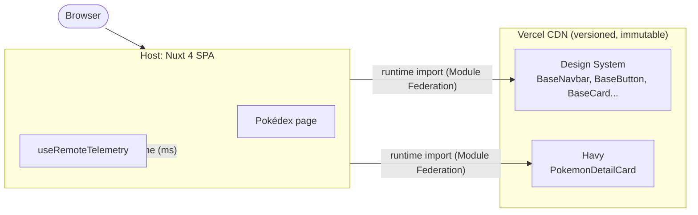

# 🏢 Principal (Host Application)

> Nuxt 4 SPA that orchestrates the Micro-Frontends architecture, consuming remote modules from **Design System** and **Havy** via Module Federation.

## Architecture

```
Principal (Host)
├── consumes → Design System (BaseNavbar, BaseButton, BaseCard…)
├── consumes → Havy (PokemonDetailCard)
└── own pages → Pokédex Grid (index.vue)
```



## Related repos

| Repo | Role | Live |
|---|---|---|
| [`design-system`](https://github.com/theussoares/design-system) | Remote: reusable UI components|
| [`havy`](https://github.com/theussoares/havy) | Remote: Pokémon detail feature | n/a |
| **this repo** | Host: orchestrates both remotes | [demo](https://principal-rho.vercel.app) |

The Host **never bundles** remote code. Components are loaded at runtime from CDN-hosted versioned artifacts.

## Tech Stack

| Layer      | Technology                         |
| ---------- | ---------------------------------- |
| Framework  | Nuxt 4 (SPA mode, `ssr: false`)    |
| Federation | `@originjs/vite-plugin-federation` |
| Styling    | TailwindCSS                        |
| Fonts      | Google Fonts (Inter)               |
| Deploy     | Vercel                             |

## Getting Started

```bash
# Install dependencies
npm install

# Start dev server (port 3001)
npm run dev -- --port 3001

# Build for production
npm run build

# Preview production build
npm run preview
```

> ⚠️ Remotes must be running locally before the Host can load them:
>
> - Design System on `http://localhost:5001`
> - Havy on `http://localhost:5002`

## Environment Variables

| Variable                   | Default                 | Description                                            |
| -------------------------- | ----------------------- | ------------------------------------------------------ |
| `NUXT_PUBLIC_DS_URL`       | `http://localhost:5001` | Design System remote URL                               |
| `NUXT_PUBLIC_HAVY_URL`     | `http://localhost:5002` | Havy remote URL                                        |
| `NUXT_PUBLIC_DS_VERSION`   | `latest`                | Design System version to consume (`latest` or `1.0.0`) |
| `NUXT_PUBLIC_HAVY_VERSION` | `latest`                | Havy version to consume (`latest` or `1.0.0`)          |

### Rollback

To rollback a remote to a specific version, set the env var:

```bash
NUXT_PUBLIC_HAVY_VERSION=1.0.0  # pins to v1.0.0 instead of latest
```

No rebuild required — the Host resolves the version at runtime.

## Project Structure

```
principal/
├── app.vue               # Layout + BaseNavbar (remote)
├── pages/
│   └── index.vue         # Pokédex grid page
├── composables/
│   ├── usePokedex.ts     # Pokémon data fetching & state
│   └── useRemoteTelemetry.ts  # Remote import tracking (load time in ms)
├── types/                # TypeScript definitions
├── nuxt.config.ts        # Federation config + runtime config
├── vercel.json           # CDN cache + CSP + security headers
└── public/               # Static assets
```

## Security

Configured in `vercel.json`:

- **CSP** — scripts restricted to `self` + authorized remote CDNs
- **X-Content-Type-Options** — `nosniff`
- **X-Frame-Options** — `DENY`
- **Referrer-Policy** — `strict-origin-when-cross-origin`
- **Cache** — `/_nuxt/**` assets cached for 1 year (immutable)

## Key Concepts

- **`defineAsyncComponent`** + **`ClientOnly`** — remotes loaded lazily, client-side only (SSR incompatible with Module Federation)
- **`shared: ['vue']`** — Host and remotes share the same Vue instance
- **Telemetry** — every remote import is tracked via `useRemoteTelemetry` with load time in ms
